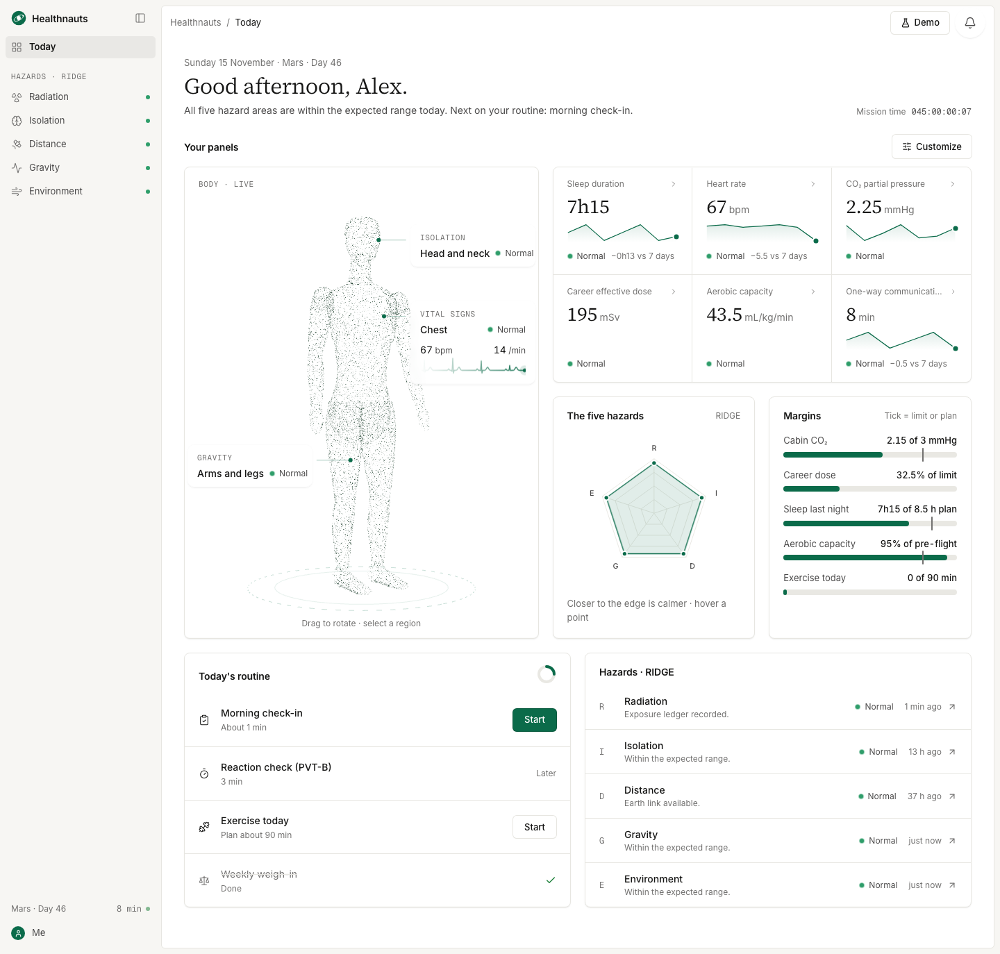
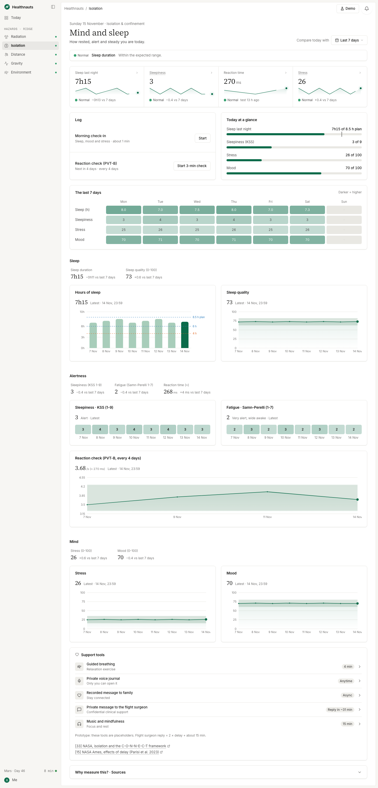
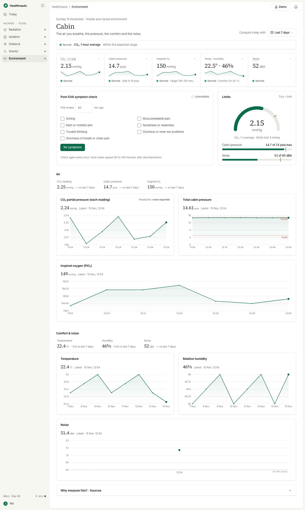
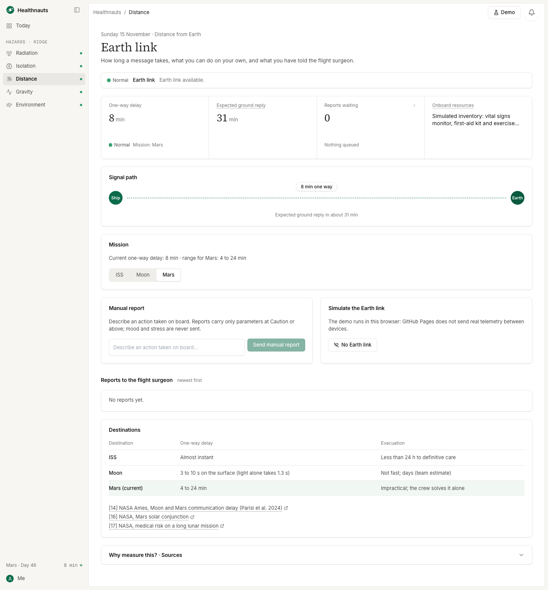
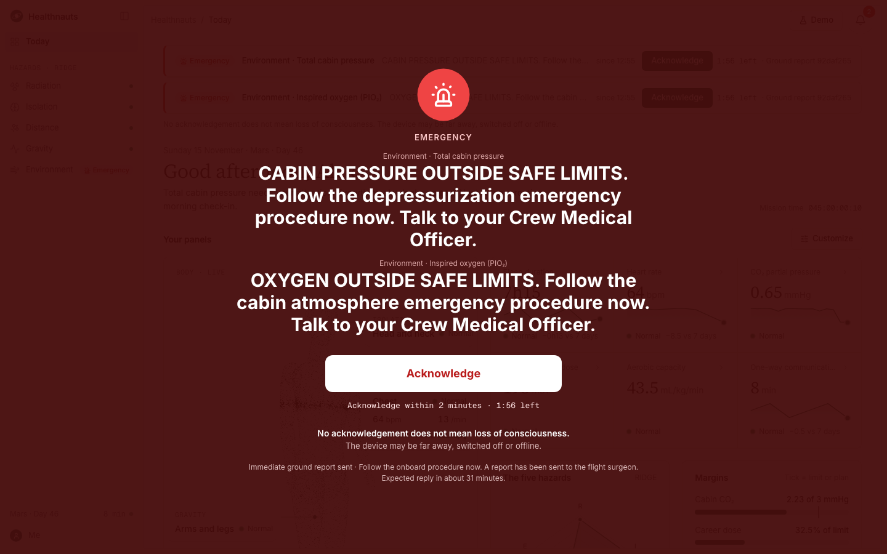
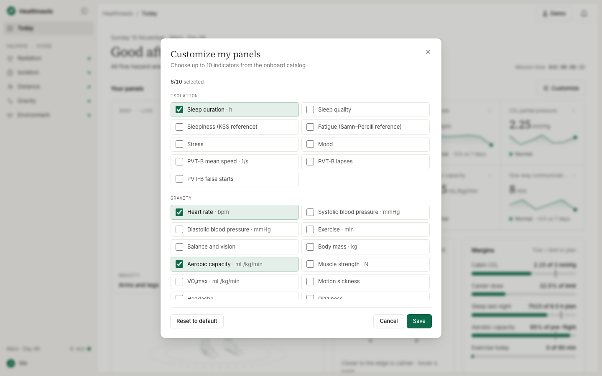

# Healthnauts

> Autonomous crew health monitoring for long space missions, built so astronauts can understand and act on their own health data when Earth is minutes away.

**Live demo:** https://mendezinxd.github.io/NasaSpaceAppsChallenge2026/
**Challenge:** NASA Space Apps Challenge 2026, "Create Health Monitoring Software for Astronauts on Space Missions"
**Team:** Black Belt's Team, Ouro Preto, Brazil
**Design system:** [`docs/DESIGN_SYSTEM.md`](docs/DESIGN_SYSTEM.md) (colors, type, spacing, pieces, charts, motion, how to extend)

All data in the demo is simulated. Healthnauts supports self-monitoring and crew medical decisions. It does not diagnose any condition.

---

## Contents

- [Screenshots](#screenshots)
- [The problem](#the-problem)
- [What Healthnauts does](#what-healthnauts-does)
- [How it works](#how-it-works)
- [Try the demo](#try-the-demo)
- [NASA data and scientific basis](#nasa-data-and-scientific-basis)
- [Design system](#design-system)
- [Run it locally](#run-it-locally)
- [Architecture](#architecture)
- [Limitations and next steps](#limitations-and-next-steps)
- [Use of AI](#use-of-ai)
- [Team](#team)
- [References](#references)

---

## Screenshots

| Overview | Isolation (Mind and Sleep) |
|---|---|
|  |  |

| Cabin Environment | Ground Control |
|---|---|
|  |  |

| Emergency alert | Customizable panels |
|---|---|
|  |  |

---

## The problem

On the International Space Station, a flight surgeon on Earth answers within seconds and an evacuation can happen in less than 24 hours. On the way to Mars, a message takes 4 to 24 minutes each way, and for about two weeks every two years (solar conjunction) there is no contact at all.

Crews on deep space missions will need to notice health problems early and respond on their own. NASA groups the hazards of human spaceflight into five categories, known as **RIDGE**: space **R**adiation, **I**solation and confinement, **D**istance from Earth, **G**ravity fields and hostile/closed **E**nvironments. Healthnauts is organized around exactly these five hazards.

## What Healthnauts does

- **Shows the day at a glance.** The Overview opens with one sentence about how the astronaut is doing today and what to do next, a "Next up" routine bar, a clickable body and up to 10 panels the astronaut chooses.
- **Uses 5 alert levels plus "Unavailable".** Normal, Advisory, Caution, Warning and Emergency (names from the alert section of NASA-STD-3001 Vol. 2), always with color, icon and text. Emergency is reserved for vehicle safety conditions with an official limit (cabin pressure, inspired oxygen), never for a health score.
- **Asks for acknowledgement.** Warning and Emergency alerts must be acknowledged. If they are not, the alert escalates to the Crew Medical Officer and the report to Earth is marked "not acknowledged". The app states clearly that no acknowledgement does not mean loss of consciousness.
- **Simulates the report to Earth with the real delay.** Reports move through QUEUED, SENT, RECEIVED and REPLIED, with the expected reply time calculated as `sent + 2 × one-way delay + 15 min`. Without a link, the report waits in the queue and the onboard procedure is shown instead.
- **Compares each astronaut with themselves.** Sleep quality, stress, mood and reaction time are compared with a personal range (mean ± 2 SD of the first days), not with a generic population average.
- **Measures alertness with a real test.** A 3-minute Psychomotor Vigilance Test (PVT-B), timed with `performance.now()`, plus a 1-minute morning check-in.
- **Explains every number.** Each indicator has a "Why measure this?" text and the source of its limit.

## How it works

| RIDGE hazard | Screen | What is monitored |
|---|---|---|
| Isolation and confinement | Isolation | Sleep duration and quality, Karolinska Sleepiness Scale, Samn-Perelli fatigue, stress, mood, PVT-B reaction time |
| Gravity fields | Gravity | Aerobic capacity and strength vs. preflight, body mass, symptoms, bone protection tracking, post-landing check |
| Hostile/closed environments | Environment | ppCO₂ (1-hour and 7-day averages), inspired O₂ (PIO₂), cabin pressure, temperature and humidity, noise |
| Space radiation | Radiation | Career effective dose vs. limit, solar particle events (SPE and ESPE), EVA status |
| Distance from Earth | Distance and Ground Control | One-way delay for ISS, Moon and Mars, link status, report cycle |
| (vital signs) | Overview | Heart rate, respiratory rate, blood pressure, SpO₂, temperature, with NEWS2 as an experimental terrestrial reference |

The interface never decides a level by itself. All levels and messages come from a rules layer (`shared/`) where every limit is tied to a source or marked as a team proposal. The full audit is in [`docs/verificacao.md`](docs/verificacao.md).

### Alert levels

| Level | Meaning | What the app does |
|---|---|---|
| Normal | Expected for the context | Records |
| Advisory | Worth following, no immediate action | Shows in summary and detail |
| Caution | Needs to be checked today | Notification |
| Warning | Requires a response by procedure | Strong notification, mandatory acknowledgement, report to Earth |
| Emergency | Predefined vehicle safety criterion | Full screen, 2-minute acknowledgement, immediate report |
| Unavailable | No reliable data (stale or missing) | Asks for a new measurement |

## Try the demo

Open the [live demo](https://mendezinxd.github.io/NasaSpaceAppsChallenge2026/) and use the **Demo** panel to run a scenario. Each one changes the data and the app reacts as it would on board:

- One hour of elevated cabin CO₂
- Simulated solar event
- A week of short sleep
- Fitness change and reported symptoms
- Mars communication outage and local report
- Cabin pressure loss (Emergency)
- Cabin sensor offline
- Fever with a high early warning score
- Exercising (live sensor)

Use **Back to nominal** to return the live sensor to normal readings and **Reset demo** to start over.

You can also change the mission (ISS, Moon, Mars) on the Distance screen and watch the communication delay and reply time change. The demo uses one delay inside each range (ISS 0.3 s, Moon 10 s, Mars 8 min).

## NASA data and scientific basis

Healthnauts is built on NASA standards and research, not on generic wellness rules.

- **NASA-STD-3001 Vol. 2 Rev. F (July 2026)**, the current NASA Spaceflight Human-System Standard. Environmental limits were checked against its text: PIO₂ 145 to 155 mmHg normoxia, 356 mmHg indefinite hyperoxia, 127 mmHg mild hypoxia [V2 6003]; 1-hour ppCO₂ no more than 3 mmHg [V2 6004]; cabin pressure above 5 and up to 15.0 psia [V2 6006]; temperature and humidity envelope [V2 6012]; 85 dBA hazardous noise limit [V2 6077].
- **NASA-STD-3001 Vol. 1 Rev. C**: career radiation limit (600 mSv), sleep and medical operations.
- **NASA Human Research Program** evidence reports and OCHMO technical briefs (CO₂, habitable atmosphere, acoustics, decompression sickness, cardiovascular adaptations, bone loss, SANS).
- **NASA Standard Measures** and the ISS **Reaction Self Test**, which inspired the check-in and the PVT-B.
- **NASA Ames** studies on communication delay for Moon and Mars missions.

Where NASA does not publish a number, the app uses established external references (NEWS2, KSS, Samn-Perelli, PVT-B validation) and labels them. Full list in [References](#references).

## Design system

The visual layer was redesigned as a small, central design system: **change a value in one place and the whole app changes.**

- All colors, alert-level colors and the type scale live in [`src/design/tokens.ts`](src/design/tokens.ts). They become CSS variables at startup, which Tailwind, the global CSS, the charts and the 3D body all read.
- Every screen is a `<Pagina>` (header + blocks, always 20 px apart) built from the pieces in `src/ui/` (`Painel`, `Numero`, `NumerosGrid`, charts) and `src/components/charts.tsx`.
- The rules (what each color means, type scale, spacing, motion, what never to do) and recipes (new screen, new color, new chart) are in **[`docs/DESIGN_SYSTEM.md`](docs/DESIGN_SYSTEM.md)**. Read it before changing anything visual.
- The science layer (`shared/`: alert levels, limits, calculations) was not touched by the redesign, and the interface never decides a level by itself.

## Run it locally

Requirements: [Node.js](https://nodejs.org/) 22 or newer and [Git](https://git-scm.com/).

```bash
git clone https://github.com/mendezinxd/NasaSpaceAppsChallenge2026.git
cd NasaSpaceAppsChallenge2026
npm install
npm run dev
```

Open the address shown in the terminal (usually http://localhost:5173).

Other commands:

```bash
npm test            # 93 automated tests (rules, alerts, ground reports, scenarios, panels)
npm run build       # production build in dist/
npm start           # optional Express server ("onboard computer") using the same rules
```

On Windows machines that block PowerShell scripts, use `npm.cmd` instead of `npm` (for example `npm.cmd install`).

Every push to `main` runs the tests, builds the site and publishes it to GitHub Pages (`.github/workflows/pages.yml`).

## Architecture

```
shared/    Rules layer in plain JavaScript: alert levels, evaluations, alerts,
           ground reports, scenarios, router. Runs in the browser and in Node.
server/    Optional Express server using the same shared/ routes.
src/       React + TypeScript front-end (Vite, Tailwind, Recharts, Framer Motion, Zustand).
test/      Node test runner suites for rules and front-end logic.
docs/      Specification, verification audit, API notes.
```

In the published site, the rules run in the browser through a small local router, so the app works as a static page. On a real vehicle this layer would run on the onboard computer, which is what the Express server represents.

Main libraries: React, React Router, Vite, TypeScript, Tailwind CSS, Recharts, Framer Motion, Zustand, lucide-react, react-body-highlighter, Geist font (via Fontsource), Express.

## Limitations and next steps

- All data is simulated. There is no connection to real sensors.
- Five rules from the specification are not implemented yet (signal quality flag, NEWS2 combined with personal range, weekly exercise minutes, planned vs. performed strength, fluid loading reminder). See [`docs/verificacao.md`](docs/verificacao.md).
- The temperature and humidity envelope is simplified as a rectangle, and noise uses dBA approximations of NC curves.
- Browser storage (`localStorage`) is not secure access control. Privacy of mood and stress data is a design proposal, not implemented security.
- Next steps: watch and tablet versions, crew view for the Crew Medical Officer, and validation with professionals in aerospace medicine.

## Use of AI

In line with the Space Apps rules, we declare our use of AI:

- **The idea, the research questions, the choice of indicators, the alert design and all product decisions were made by the team.**
- AI assistants (Anthropic Claude, including Claude Code) were used to help summarize research, draft the technical specification from the team's decisions, and write and review code under the team's direction. All generated code was reviewed and tested by the team.
- No AI-generated images or videos are used in the app. No NASA logos, flags or mission identifiers are used.

## Team

Black Belt's Team, NASA Space Apps Challenge 2026, Ouro Preto (Brazil):

- **Samuel**: front-end
- **Bernardo**: back-end
- **Adriane**: research, radiation and distance from Earth
- **Matheus**: research, isolation and confinement
- **Rafael**: research, gravity fields
- **Augusto**: research, hostile and closed environments

## References

**NASA**

- NASA-STD-3001 Vol. 2 Rev. F (2026): https://standards.nasa.gov/system/files/tmp/NASA-STD-3001%20Vol%202%20Rev%20F.pdf
- NASA-STD-3001 Vol. 1 Rev. C: https://standards.nasa.gov/sites/default/files/standards/NASA/C//nasa-std-3001-vol-1-rev-c-signature.pdf
- NASA-STD-3001 Vol. 1, Medical Operations [V1 6001]: https://www.nasa.gov/reference/6-0-medical-operations/
- NASA-STD-3001 Vol. 2, Natural and Induced Environments: https://www.nasa.gov/reference/6-0-natural-and-induced-environments-vol-2
- OCHMO-TB-004 Carbon Dioxide: https://www.nasa.gov/wp-content/uploads/2023/12/ochmo-tb-004-carbon-dioxide.pdf
- OCHMO-TB-003 Habitable Atmosphere: https://www.nasa.gov/wp-content/uploads/2023/12/ochmo-tb-003-habitable-atmosphere.pdf
- OCHMO Acoustics technical brief: https://www.nasa.gov/sites/default/files/atoms/files/acoustics_technical_brief_ochmo_0.pdf
- Goodman, spacecraft acoustics (NC curves in dBA): https://ntrs.nasa.gov/api/citations/20090043801/downloads/20090043801.pdf
- OCHMO Decompression Sickness technical brief: https://www.nasa.gov/sites/default/files/atoms/files/dcs_technical_brief_ochmo.pdf
- NASA OSDR Environmental Data App: https://visualization.osdr.nasa.gov/eda
- NASA SRAG, ISS radiation operations (SPE and ESPE): https://www.nationalacademies.org/cdn/materials/9fba0b8d-da37-49fe-9fc5-45b736630da3
- NASA RadWorks, solar event shelter: https://ntrs.nasa.gov/api/citations/20150001237/downloads/20150001237.pdf
- Parisi et al. 2024, communication delay for Moon and Mars (NASA Ames): https://ntrs.nasa.gov/api/citations/20240006867/downloads/Proof_Slides_Parisi_Megan_969.pdf
- Parisi et al. 2023, effects of communication delay (NASA Ames): https://ntrs.nasa.gov/api/citations/20230010972/downloads/Proof_Slides_Parisi_Megan_797.pdf
- NASA, Mars solar conjunction: https://mars.nasa.gov/mars2020/mission/status/337/hunkering-down-for-solar-conjunction
- NASA, medical risk on a long lunar mission: https://ntrs.nasa.gov/api/citations/20240011063/downloads/Quantifying%20Risk%20on%20a%20Long%20Duration%20Lunar%20Mission.pdf
- NASA, ISS ocular surveillance: https://ntrs.nasa.gov/api/citations/20170009173/downloads/20170009173.pdf
- NASA HRP, Risk of Cardiovascular Adaptations: https://www.nasa.gov/reference/risk-of-cardiovascular-adaptations/
- NASA HRP, Risk of Spaceflight-Induced Bone Changes: https://www.nasa.gov/reference/risk-of-spaceflight-induced-bone-changes/
- NASA HRP, SANS: https://www.nasa.gov/reference/risk-of-spaceflight-associated-neuro-ocular-syndrome-sans/
- NASA Standard Measures: https://www.nasa.gov/reference/standard-measures/
- NASA BHP Standard Measures: https://ntrs.nasa.gov/api/citations/20170005421/downloads/20170005421.pdf
- Reaction Self Test on the ISS: https://pmc.ncbi.nlm.nih.gov/articles/PMC8919197
- Arsintescu et al. 2019, NASA Ames (KSS, Samn-Perelli): https://hsi.arc.nasa.gov/publications/Arsintescu_etal_2019_JoVE.pdf
- NASA Spinoff 2013, Reaction Self Test: https://spinoff.nasa.gov/Spinoff2013/hm_1.html
- NASA, lessons from astronauts on isolation: https://www.nasa.gov/humans-in-space/isolation-what-can-we-learn-from-the-experiences-of-nasa-astronauts/

**External references**

- Norsk et al. 2015, J Physiol: https://doi.org/10.1113/jphysiol.2014.284869
- Freeman et al. 2011, orthostatic hypotension consensus (MSD Manual): https://www.msdmanuals.com/professional/cardiovascular-disorders/symptoms-of-cardiovascular-disorders/orthostatic-hypotension
- NEWS2, Royal College of Physicians: https://www.rcp.ac.uk/resources/national-early-warning-score-news-2/
- Karolinska Sleepiness Scale (Åkerstedt and Gillberg, 1990)
- Samn-Perelli fatigue scale, USAF SAM-TR-82-21: https://apps.dtic.mil/sti/pdfs/ADA125319.pdf
- Basner, Mollicone and Dinges 2011, PVT-B validation: https://www.med.upenn.edu/uep/assets/user-content/documents/Basner2011-ValidityandsensitivityofabriefPVT.pdf
- ESA, communication latency study: https://nebula.esa.int/sites/default/files/neb_study/3142/C4000136202FR.pdf

Open source libraries are listed in `package.json`, each under its own license.
